# Resultados — Previsão do Preço da Gasolina com Redes Recorrentes (ANP)

> **Prof. Dr.**: _Sérgio Canuto_

> **Integrantes do grupo**: _Robson Pereira da Silva e Ivânio José da Rocha Júnior_

> **Link do repositório GitHub**: [_https://github.com/robsonpsdesv/previsao-gasolina-anp-rnn_](https://github.com/robsonpsdesv/previsao-gasolina-anp-rnn)

## 1. Problema e objetivo

Previsão, um passo à frente, do **preço médio de revenda da gasolina comum no Brasil
na semana seguinte** ($X_{t-n+1..t} \rightarrow y_{t+1}$), a partir da série semanal
multivariada de preços de combustíveis da ANP. Comparação controlada entre
**SimpleRNN, GRU e LSTM**, variando janela temporal, unidades, profundidade e
regularização, com busca de hiperparâmetros via Optuna. A formulação segue o conteúdo de
redes recorrentes das aulas (CANUTO, 2026): instâncias formadas por janelas deslizantes,
arquitetura many-to-one, comparação SimpleRNN × LSTM × GRU e validação temporal sem uso de
informação futura.

## Resumo dos resultados em duas etapas

Os resultados estão organizados em duas etapas, com a comparação final contra a persistência
(split 60/20/20, métricas em R$/L):

| Etapa | Principal resultado | Interpretação |
|---|---|---|
| **Etapa 1** — Previsão em nível de preço (seções 4 a 11) | GRU, MAE validação 0,435 | Melhor recorrente nessa formulação, mas generalização insatisfatória (MAE teste 1,322; R² teste -5,265): fora da faixa de preços do treino, as ativações saturam e a previsão fica quase constante (seção 6) |
| **Etapa 2** — Previsão com log-retornos (seção 12) | SimpleRNN, MAE validação 0,0313 | Forte melhora com representação transformada (MAE teste 0,0412; R² teste 0,9804) |
| **Validação cruzada temporal e walk-forward** (seção 14) | GRU em log-retorno escolhida pela CV, MAE teste 0,0389 com re-treino | Empata com a persistência no MAE e tem RMSE 8% menor; GRU e LSTM superam a SimpleRNN na CV; em nível, o re-treino reduz o MAE de teste em 79% a 92%, mas ele continua 4,6 a 10,7 vezes o da persistência |
| **Comparação final com persistência** (seções 13 a 15) | MAE teste de 0,0390 | Referência mais difícil de bater: as redes da Etapa 2 apenas se aproximam no hold-out (diferença de ~0,001 a 0,002 R$/L) e empatam com re-treino periódico; nenhuma rede a supera de forma clara |

A seção 13 repete a análise em outros splits cronológicos para ambas as etapas, e a seção 14 aplica a validação cruzada temporal (`TimeSeriesSplit`) apresentada nas aulas e avalia o teste com re-treino periódico (walk-forward). Todos os números deste relatório foram obtidos **após a correção das fronteiras temporais** descrita na seção 3 (antes dela, o alvo da última linha de treino pertencia à primeira semana de validação).

## 2. Fonte e caracterização do dataset

- **Fonte**: ANP — Série Histórica do Levantamento de Preços, agregado semanal nacional
  (`semanal-brasil-2004-a-2012.xlsx` + `semanal-brasil-desde-2013.xlsx`), baixados
  diretamente para `datasets/anp_combustiveis/raw/`.
- **Período**: 2004-05-09 a 2026-09-06 (1152 semanas após a construção da série e do
  alvo em `t+1`).
- **Granularidade**: semanal, nível Brasil (nacional), evitando misturar estados/municípios.
- **Produtos usados**: gasolina comum, etanol hidratado, óleo diesel.
- **Features** (8, todas em `t`): preço médio, mínimo, máximo, desvio padrão e
  coeficiente de variação da gasolina; número de postos pesquisados; preço médio do
  etanol; preço médio do diesel.
- **Alvo**: preço médio de revenda da gasolina em `t+1` (R$/litro).
- **Qualidade dos dados**: sem valores ausentes ou duplicados após o pivot; 4 lacunas
  pontuais na periodicidade semanal (maior delas 63 dias, em outubro/2020) que não
  comprometem a construção das janelas, pois `create_sequences` opera sobre a ordem
  das observações disponíveis, não sobre datas de calendário.

### Análise exploratória

Estatísticas e gráficos gerados por `python -m src.eda`
([`results/eda_estatisticas_features.csv`](../results/eda_estatisticas_features.csv) e
[`results/eda_estatisticas_por_split.csv`](../results/eda_estatisticas_por_split.csv)); os
gráficos são exibidos adiante. A curtose é a curtose em excesso (0 para a normal).

**Features (série completa, 1152 semanas)**

| Feature | Média | Desvio | Mín. | Mediana | Máx. | Assimetria |
|---|---:|---:|---:|---:|---:|---:|
| gasolina_preco_medio (R$/L) | 3,83 | 1,44 | 2,08 | 3,30 | 7,39 | 0,73 |
| gasolina_preco_minimo (R$/L) | 3,17 | 1,19 | 1,39 | 2,75 | 6,29 | 0,75 |
| gasolina_preco_maximo (R$/L) | 5,11 | 1,95 | 2,85 | 4,52 | 9,79 | 0,81 |
| gasolina_desvio_padrao (R$/L) | 0,24 | 0,09 | 0,135 | 0,198 | 0,535 | 0,62 |
| gasolina_coef_variacao | 0,062 | 0,006 | 0,049 | 0,062 | 0,083 | 0,40 |
| gasolina_num_postos | 7163 | 2776 | 485 | 7229 | 12701 | 0,32 |
| etanol_preco_medio (R$/L) | 2,59 | 1,07 | 1,20 | 2,20 | 5,54 | 0,69 |
| diesel_preco_medio (R$/L) | 3,34 | 1,65 | 1,44 | 2,81 | 7,57 | 0,95 |

**Preço da gasolina e log-retorno semanal por split (60/20/20, partições por data-base `t`)**

| Split | Média | Desvio | Mín. | Mediana | Máx. | Retorno: média | Retorno: desvio | Retorno: curtose | Retorno: autocorr. lag 1 |
|---|---:|---:|---:|---:|---:|---:|---:|---:|---:|
| Treino | 2,79 | 0,43 | 2,08 | 2,62 | 3,78 | 0,0009 | 0,0072 | 59,7 | 0,15 |
| Validação | 4,78 | 0,84 | 3,80 | 4,47 | 7,27 | 0,0028 | 0,0116 | 11,8 | 0,48 |
| Teste | 5,99 | 0,57 | 4,79 | 6,10 | 7,39 | -0,0004 | 0,0136 | 14,8 | 0,47 |

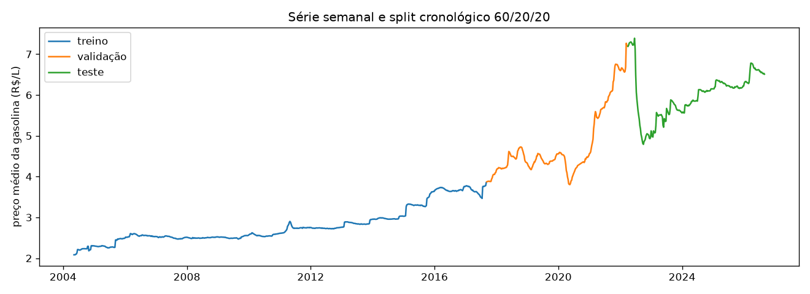

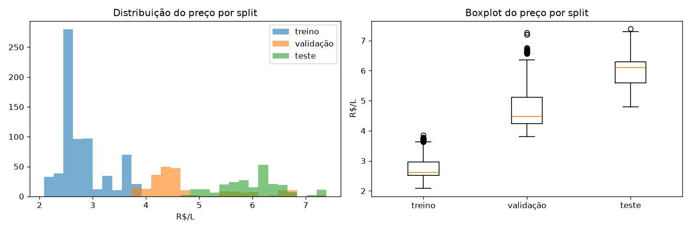

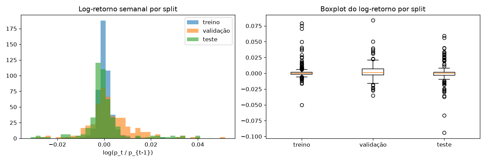

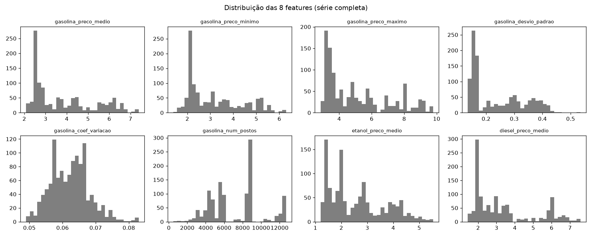

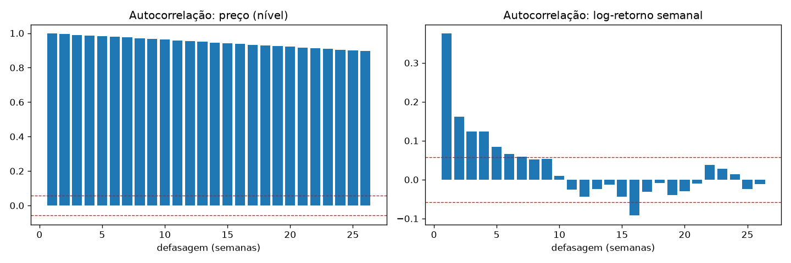

Observações:

- **Deslocamento de nível entre os splits**: as medianas do preço são 2,62, 4,47 e 6,10
  R$/L (treino, validação, teste), e as distribuições de treino e teste praticamente não
  se sobrepõem (máximo do treino 3,78; mínimo do teste 4,79).
- **Log-retorno semanal**: a média é próxima de zero nos três splits, mas o desvio
  aumenta (0,0072 → 0,0116 → 0,0136) e as caudas são pesadas (curtose em excesso entre 12 e 60), com choques como -9,4% na semana de 2022-07-03 e +8,4% em 2022-03-13. Ou
  seja, a série de retornos tem escala mais estável que o nível, mas não é homogênea.
- **Autocorrelação**: o preço em nível é altamente persistente (0,997 na defasagem 1 e
  0,897 na defasagem 26), o que é compatível com a força do baseline de persistência. O
  log-retorno tem autocorrelação positiva até cerca de 9 semanas (0,375 na defasagem 1
  na série completa; 0,15, 0,48 e 0,47 por split), indicando alguma dependência de
  curto prazo que um modelo poderia explorar.
- **Features de contagem não estacionárias**: `gasolina_num_postos` cresce de 485 a
  12.701 postos pesquisados ao longo da série, o que sugere mudança na abrangência da
  pesquisa (observação descritiva; não foi investigada a causa).
- Todas as features têm assimetria positiva moderada (0,3 a 0,95).

## 3. Pré-processamento e protocolo experimental

- **Split cronológico** (sem embaralhamento), **60% treino / 20% validação / 20%
  teste**, definido para que os **alvos** de cada partição fiquem no seu próprio
  período. Por data-base `t`: treino 2004-05-09 a 2017-08-27 (690 semanas), validação
  2017-09-03 a 2022-03-20 (230) e teste 2022-03-27 a 2026-08-30 (232); os alvos
  (`t+1`) correspondentes vão até 2017-09-03, de 2017-09-10 a 2022-03-27 e de
  2022-04-03 a 2026-09-06. Verificado automaticamente: `max(train) < min(val)`,
  `max(val) < min(test)` e, em `python -m src.eda`, que o último alvo de cada
  partição precede o primeiro alvo da seguinte, para todos os splits, janelas e alvos. Proporções definidas em `src/config.py`
  (`TRAIN_FRAC`, `VAL_FRAC`, `TEST_FRAC`).
- **Normalização**: `StandardScaler` ajustado **somente no treino** (features e alvo
  separadamente), escolhido em vez de `MinMaxScaler` porque os preços de combustível
  não têm limite superior conhecido a priori e os períodos de validação e teste, como
  discutido abaixo, ultrapassam a faixa observada no treino — a padronização por
  z-score não "trava" a escala nos extremos vistos no treino. Isso, porém, não impede que
  as ativações da rede (sigmoide e tanh) saturem fora dessa faixa (seção 6).
- **Janelas**: 4, 12 e 26 semanas, geradas por `create_sequences(X, y, window_size)`.
- **Protocolo comparável**: mesmo batch size (32), mesma loss (MSE) e métrica (MAE),
  mesmo otimizador (Adam, `learning_rate=1e-3` fora do Optuna),
  `EarlyStopping(patience=15, restore_best_weights=True)` e
  `ReduceLROnPlateau(factor=0.5, patience=5, min_lr=1e-6)` monitorando a loss de validação,
  mesma seed (42) e lotes em ordem cronológica (`shuffle=False`) em todos os treinos. Manter
  a ordem dos lotes é uma escolha de protocolo: o cuidado contra o uso de informação futura,
  enfatizado nas aulas, está na separação temporal entre treino, validação e teste, e não na
  ordem dos lotes dentro do treino. Quando usado, o L2 incide só nos pesos de entrada
  (`kernel_regularizer`).
- **Baseline**: persistência ($\hat{y}_{t+1} = y_t$).
- **Curvas de treino**: loss e MAE são exibidas na unidade original (R$/L em nível;
  log-retorno na Etapa 2), convertidas da escala padronizada pelo desvio σ do scaler do
  alvo (MAE × σ, MSE × σ²).
- **Custo**: além do tempo total de treino, registra-se a mediana do tempo por época sem a
  1ª época, que inclui a construção do grafo do TensorFlow.
- **Validação cruzada temporal**: além do hold-out 60/20/20, a seção 14 aplica
  `TimeSeriesSplit` com janela expansível (PEDREGOSA et al., 2011), como nas aulas, e avalia
  o período de teste re-treinando o modelo a cada bloco de semanas (walk-forward).

### Arquiteturas recorrentes avaliadas (fundamentação das aulas)

O problema segue o formato **many-to-one** visto nas aulas: cada instância é uma janela das
`w` semanas anteriores (com `w = 4`, entrada `[x_{t-3}, ..., x_t]` e alvo `y_{t+1}`). A rede
percorre a janela passo a passo, atualizando o estado oculto `h` com os **mesmos pesos em
todos os passos**, e só o último estado alimenta uma camada `Dense(1)` linear (regressão).
Nos modelos de 2 camadas, a primeira usa `return_sequences=True` e entrega à segunda a
sequência completa de estados (empilhamento). Com 8 features e 64 unidades:

| Célula | Atualização do estado (Keras) | Parâmetros recorrentes | Total com a `Dense` |
|---|---|---:|---:|
| SimpleRNN (ELMAN, 1990) | `h_t = tanh(W·x_t + U·h_{t-1} + b)` | 64·(8+64+1) = 4.672 | 4.737 |
| LSTM (HOCHREITER; SCHMIDHUBER, 1997) | portas `f_t`, `i_t`, `o_t` (sigmoide) e candidato `c̃_t` (tanh); `c_t = f_t⊙c_{t-1} + i_t⊙c̃_t`; `h_t = o_t⊙tanh(c_t)` | 4·4.672 = 18.688 | 18.753 |
| GRU (CHO et al., 2014) | portas `z_t`, `r_t` (sigmoide) e candidato `h̃_t` (tanh); `h_t = z_t⊙h_{t-1} + (1−z_t)⊙h̃_t` | 3·64·(8+64+2) = 14.208 | 14.273 |

- A LSTM tem exatamente **4×** os parâmetros recorrentes da SimpleRNN (três portas e o
  candidato), como indicado nas aulas, e a GRU, cerca de 3×. O Keras implementa a GRU na
  variante `reset_after=True` (porta de reset aplicada depois da multiplicação matricial,
  com dois vetores de bias, daí o "+2") e com a convenção `h_t = z_t⊙h_{t-1} + (1−z_t)⊙h̃_t`;
  a equação das aulas troca `z_t` por `1−z_t`, o que é equivalente.
- O treino usa **retropropagação através do tempo (BPTT)** sobre a janela inteira. O
  gradiente inclui o produto das derivadas `∂h_t/∂h_k` ao longo da janela, origem do
  desaparecimento ou da explosão do gradiente em sequências longas (BENGIO; SIMARD;
  FRASCONI, 1994; PASCANU; MIKOLOV; BENGIO, 2013), que motiva as portas da LSTM e da GRU.
  Aqui as janelas têm no máximo 26 passos; a seção 8 verifica se isso teve efeito. O
  clipping de gradiente, citado nas aulas contra a explosão, não foi usado porque nenhuma
  execução teve loss divergente ou NaN.
- **Sigmoide e tanh são limitadas e saturam**: com pré-ativações grandes, a derivada tende a
  zero e a unidade deixa de responder a variações da entrada. A seção 6 mostra que isso
  acontece quando os preços de validação e teste ficam muito acima da faixa do treino.

### Datas das entradas e dos alvos nas fronteiras dos conjuntos

Convenção: uma amostra com data-base `t` usa como entrada as `w` observações
consecutivas disponíveis `t-w+1, ..., t` e tem como alvo o preço da observação seguinte
(`t+1`, ou seja, a próxima semana disponível — a maior lacuna, em outubro/2020, tem 63
dias). Cada amostra é atribuída à partição pela data-base `t`, com as últimas linhas de
treino e de validação recuadas em um passo (`horizon`) em `chronological_split`, de modo
que o **alvo de toda amostra de uma partição cai no período de alvos dessa partição**.
Datas exatas, para todos os splits, janelas e alvos, em
[`results/fronteiras_splits.csv`](../results/fronteiras_splits.csv) (gerado por
`python -m src.eda`).

Split 60/20/20, alvo em nível:

| Janela | Partição | Amostras | Primeira entrada | Primeira base `t` | Primeiro alvo | Última base `t` | Último alvo |
|---:|---|---:|---|---|---|---|---|
| 4 | Treino | 687 | 2004-05-09 | 2004-05-30 | 2004-06-06 | 2017-08-27 | 2017-09-03 |
| 4 | Validação | 230 | 2017-08-13 | 2017-09-03 | 2017-09-10 | 2022-03-20 | 2022-03-27 |
| 4 | Teste | 232 | 2022-03-06 | 2022-03-27 | 2022-04-03 | 2026-08-30 | 2026-09-06 |
| 12 | Treino | 679 | 2004-05-09 | 2004-07-25 | 2004-08-01 | 2017-08-27 | 2017-09-03 |
| 12 | Validação | 230 | 2017-06-18 | 2017-09-03 | 2017-09-10 | 2022-03-20 | 2022-03-27 |
| 12 | Teste | 232 | 2022-01-09 | 2022-03-27 | 2022-04-03 | 2026-08-30 | 2026-09-06 |
| 26 | Treino | 665 | 2004-05-09 | 2004-10-31 | 2004-11-07 | 2017-08-27 | 2017-09-03 |
| 26 | Validação | 230 | 2017-03-12 | 2017-09-03 | 2017-09-10 | 2022-03-20 | 2022-03-27 |
| 26 | Teste | 232 | 2021-10-03 | 2022-03-27 | 2022-04-03 | 2026-08-30 | 2026-09-06 |

Datas-base das partições em cada split (o último alvo de cada partição é a semana
seguinte; o do teste é sempre 2026-09-06):

| Split | Treino (base `t`) | Validação (base `t`) | Teste (base `t`) |
|---|---|---|---|
| 60/20/20 | até 2017-08-27 | 2017-09-03 a 2022-03-20 | 2022-03-27 a 2026-08-30 |
| 70/15/15 | até 2019-11-10 | 2019-11-17 a 2023-04-23 | 2023-04-30 a 2026-08-30 |
| 75/15/10 | até 2021-02-14 | 2021-02-21 a 2024-06-02 | 2024-06-09 a 2026-08-30 |
| 80/10/10 | até 2022-03-20 | 2022-03-27 a 2024-06-02 | 2024-06-09 a 2026-08-30 |

Pontos a observar nas fronteiras:

- O **último alvo do treino (2017-09-03) é anterior ao primeiro alvo da validação
  (2017-09-10)**, e o último da validação (2022-03-27) é anterior ao primeiro do teste
  (2022-04-03). A semana de 2017-09-03 aparece apenas como último rótulo do treino e como
  primeira entrada da validação (dado passado, não informação futura).
- As **entradas das primeiras amostras de validação e teste incluem semanas da
  partição anterior** (por exemplo, com janela de 26 semanas, a validação começa a usar
  entradas de 2017-03-12 e o teste, de 2021-10-03), sempre anteriores ao instante da
  previsão.
- Os **scalers são ajustados apenas nas linhas de treino**, cujos alvos terminam em
  2017-09-03; nenhum valor do período de validação ou teste entra no ajuste.
- No alvo em log-retorno, a primeira linha da série é descartada (não há diferença para
  ela); a primeira entrada do treino passa a ser 2004-05-16 e a primeira base `t` com
  janela de 4 semanas, 2004-06-06. Os limites de validação e teste coincidem com os do
  alvo em nível.

### Correção de fronteira em relação à versão anterior dos experimentos

Uma revisão do código mostrou que, na versão anterior, a última linha de treino (data-base
2017-09-03) tinha como alvo o preço da primeira semana de validação (3,872 R$/L). Esse
valor entrava como rótulo de treino e no ajuste do `StandardScaler` do alvo (a média mudava
cerca de 0,0016 R$/L e o desvio, 0,0016 R$/L), e o mesmo ocorria na fronteira
validação/teste. O efeito numérico esperado era pequeno, mas a separação não era
estritamente temporal. A correção está em `chronological_split` (`src/preprocessing.py`) e
**todos os experimentos foram reexecutados** (`run_experiments`, `run_experiments_delta`,
`run_experiments_splits`, `eda`); as tabelas deste relatório usam apenas os novos
resultados. Comparação das métricas principais (split 60/20/20):

| Resultado | Antes | Depois |
|---|---:|---:|
| Persistência: MAE / RMSE de teste | 0,0391 / 0,0818 | 0,0390 / 0,0816 |
| Etapa 1, GRU Optuna: MAE val / MAE teste | 0,446 / 1,317 | 0,435 / 1,322 |
| Etapa 2, SimpleRNN Optuna: MAE val / MAE teste | 0,0313 / 0,0400 | 0,0313 / 0,0412 |
| Etapa 2, Optuna: configuração escolhida | 32 un., 1 camada | 64 un., 2 camadas |
| Etapa 1, 3ª melhor por MAE val | GRU + L2 (0,624) | LSTM 128 un. (0,611) |

As variações de métricas ficaram na 2ª–3ª casa decimal e as conclusões qualitativas não
mudaram; mudaram a 3ª colocada da Etapa 1 e a configuração escolhida pelo Optuna na
Etapa 2.

### Hiperparametrização (Optuna)

- **Arquitetura/janela de partida**: a melhor combinação da comparação principal
  (GRU, janela=4), usada como base para a busca.
- **Espaço de busca**: `units ∈ {16,32,64,96,128}` (capacidade), `n_layers ∈ {1,2}`
  (profundidade), `dropout ∈ [0, 0.5]` (regularização), `learning_rate ∈ [1e-4, 5e-3]`
  em escala log (velocidade/estabilidade de convergência), `batch_size ∈ {16,32,64}`
  (custo/estabilidade do gradiente). Intervalos escolhidos por serem os
  hiperparâmetros com maior potencial de alterar desempenho, generalização e custo
  computacional para redes recorrentes pequenas, conforme recomendado no enunciado.
- **Métrica otimizada**: MAE de validação (escala original, R$/L), calculada apenas
  no conjunto de validação — nunca no teste.
- **Amostrador**: TPE (`optuna.samplers.TPESampler`, seed=42), **20 tentativas**
  (`n_trials=20`), `max_epochs=60` e `patience=10` por tentativa (reduzidos frente aos
  100/15 usados na comparação principal para manter o custo da busca controlado).
- **Resultado**: melhor tentativa (trial 11) — `units=96, n_layers=2, dropout=0.096,
  learning_rate=0.00458, batch_size=64`, MAE de validação = 0.4351 R$/L (média das 20
  tentativas: 0.705). Registro completo em
  [`results/optuna_trials.csv`](../results/optuna_trials.csv) e
  [`results/optuna_best_params.json`](../results/optuna_best_params.json).
- **Modelo final**: re-treinado com os melhores hiperparâmetros e o protocolo da comparação
  principal (100 épocas, `patience=15`). Como a melhor época foi a primeira, o MAE de
  validação coincide com o do trial.

## 4. Etapa 1 — Resultados de validação em nível de preço e seleção dos modelos promissores

Tabela completa em [`results/experiments.csv`](../results/experiments.csv). Baseline
de persistência (referência; treino: MAE 0,0081, RMSE 0,0212, R² 0,9976):

| Split | MAE (R$/L) | RMSE (R$/L) | R² |
|---|---:|---:|---:|
| Validação | 0,0356 | 0,0644 | 0,9943 |
| Teste | 0,0390 | 0,0816 | 0,9792 |

Comparação principal (3 janelas × 3 arquiteturas, unidades=64, 1 camada, dropout=0,2),
por MAE de validação:

| Janela | SimpleRNN | GRU | LSTM |
|---:|---:|---:|---:|
| 4 semanas | 0,853 | **0,742** | 0,872 |
| 12 semanas | 0,849 | 0,788 | 0,874 |
| 26 semanas | 0,883 | 0,818 | 0,898 |

A GRU na janela de 4 semanas foi a melhor combinação da comparação principal e foi
usada como base para a grade de regularização e para o Optuna. As grades de unidades
e profundidade foram executadas na janela de 12 semanas.

## 5. Três melhores configurações (por MAE de validação)

| # | Config. | Unid. | Camadas | Dropout | L2 | Parâmetros | Épocas | MAE val | RMSE val | R² val | MAE teste | RMSE teste | R² teste | Tempo (s) |
|---|---|---:|---:|---:|---:|---:|---:|---:|---:|---:|---:|---:|---:|---:|
| 1 | GRU (Optuna), janela 4 | 96 | 2 | 0,096 | 0,0 | 86.497 | 16 | **0,435** | 0,768 | 0,186 | 1,322 | 1,417 | -5,265 | 4,3 |
| 2 | GRU, janela 12 | 128 | 1 | 0,2 | 0,0 | 53.121 | 22 | 0,473 | 0,747 | 0,230 | 1,246 | 1,333 | -4,541 | 4,6 |
| 3 | LSTM, janela 12 | 128 | 1 | 0,2 | 0,0 | 70.273 | 17 | 0,611 | 0,904 | -0,128 | 1,465 | 1,546 | -6,450 | 3,8 |

As duas primeiras configurações são **GRU**; a terceira é uma LSTM com 128 unidades. A 4ª
colocada por MAE de validação foi SimpleRNN com 128 unidades (0,622), seguida por GRU com L2
(0,669); a 3ª e a 4ª (0,611 e 0,622) são praticamente empatadas. Os modelos treinados das três
configurações estão em `results/models/top{1,2,3}_*.keras`.

Para cada configuração, os gráficos a seguir mostram as curvas de treino/validação, o valor
real × previsto no conjunto de teste e os resíduos. A 1ª configuração é também o melhor
resultado da busca Optuna. As curvas estão em R$/L, e o early stopping restaura a época de
menor loss de validação (na 1ª configuração, a primeira época, cujo MAE de validação de
0,435 R$/L é o da tabela). Nos gráficos de teste, a previsão fica praticamente plana
enquanto o preço real varia; a seção 6 mostra a causa.

**1ª configuração — GRU (Optuna), janela 4, 96 unidades, 2 camadas**

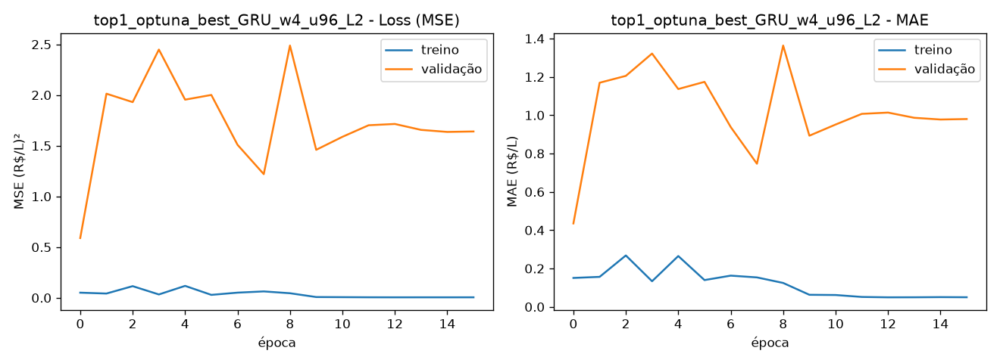

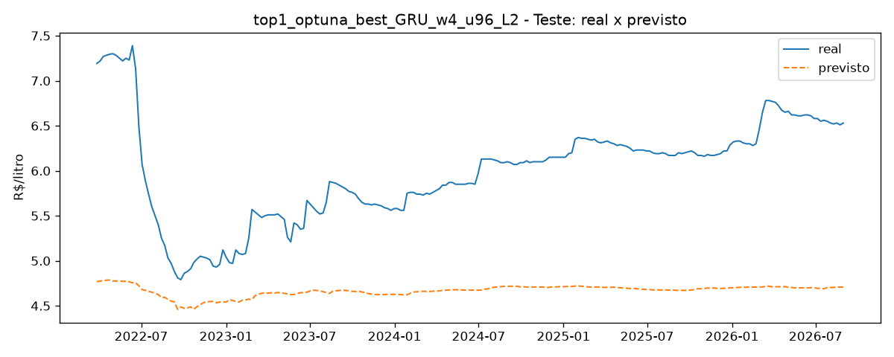

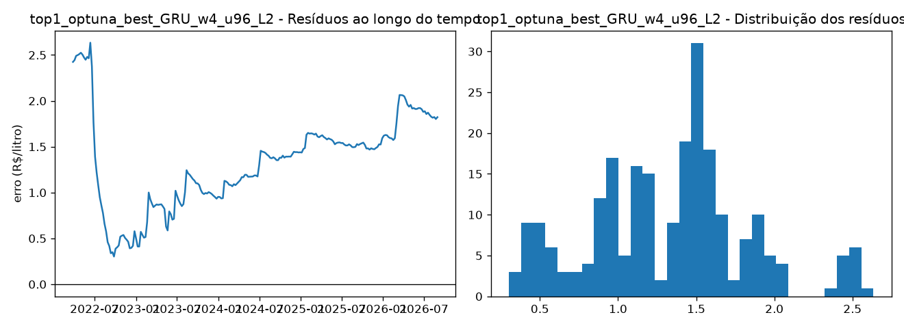

**2ª configuração — GRU, janela 12, 128 unidades, 1 camada**

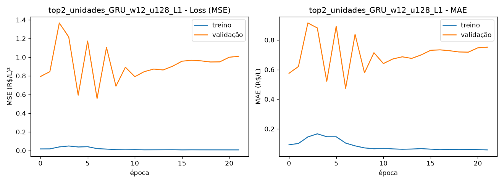

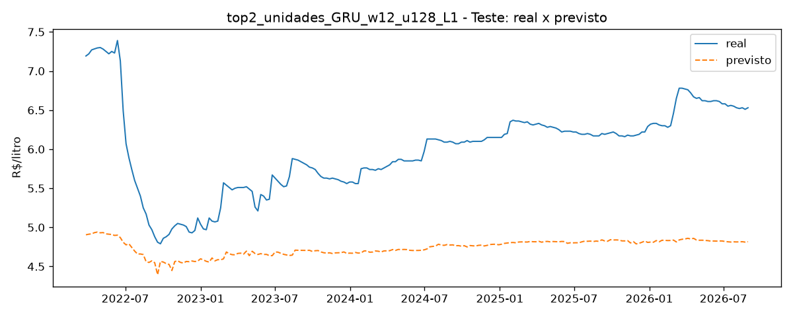

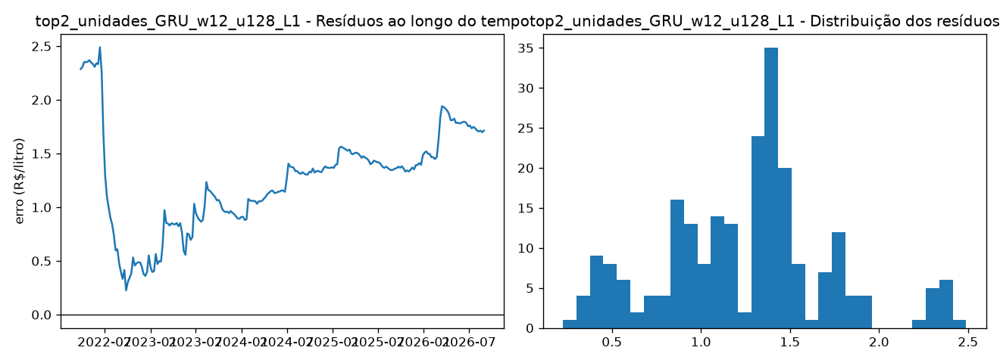

**3ª configuração — LSTM, janela 12, 128 unidades, 1 camada**

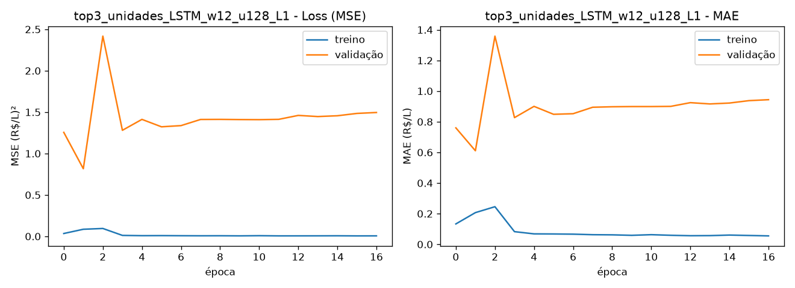

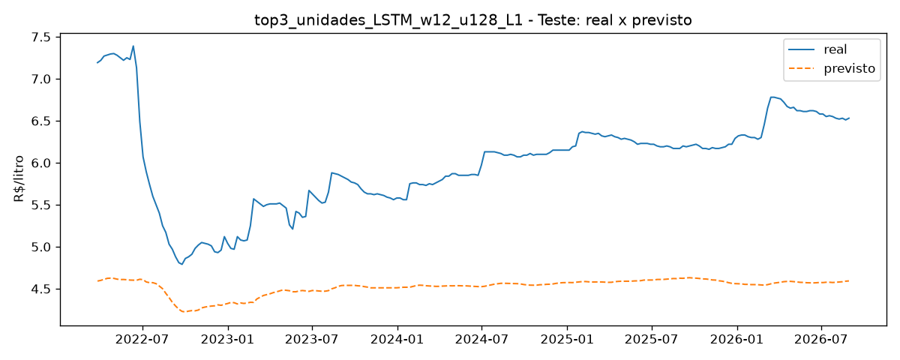

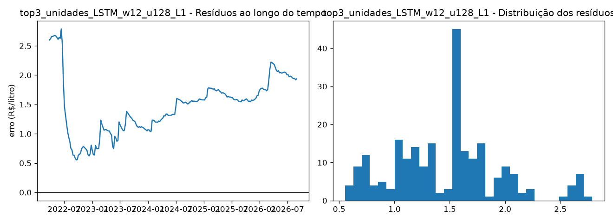

**As três arquiteturas na janela de 12 semanas (64 unidades, 1 camada)**

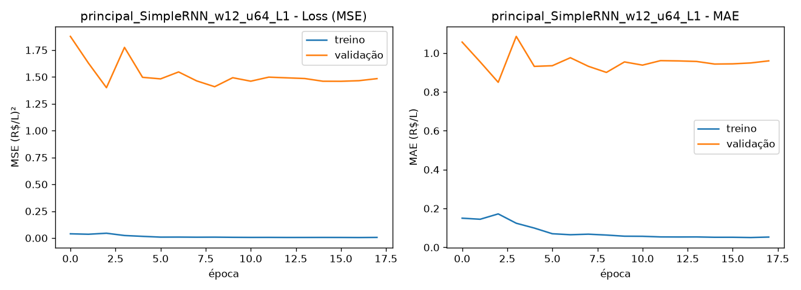

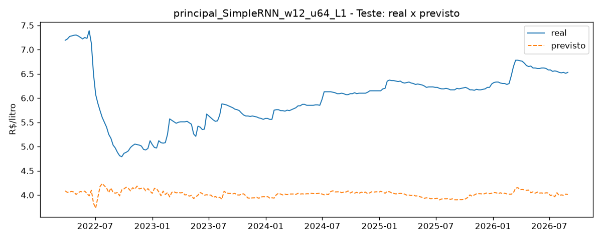

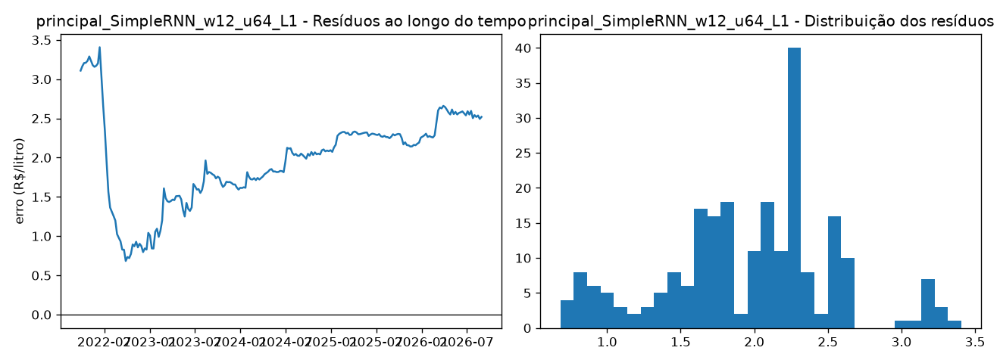

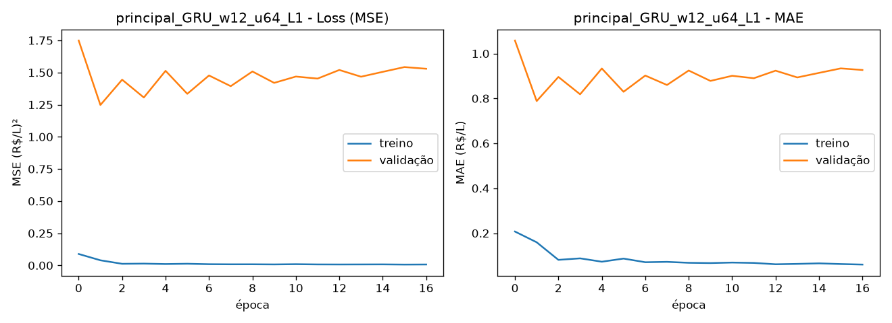

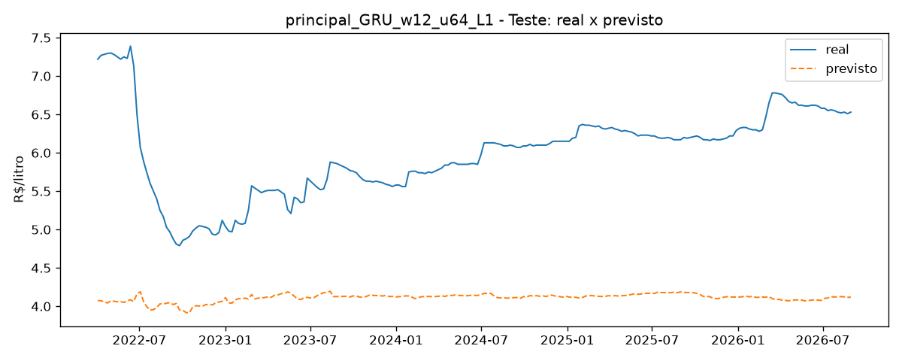

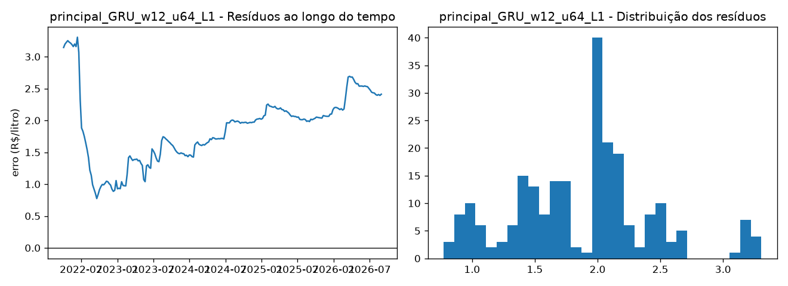

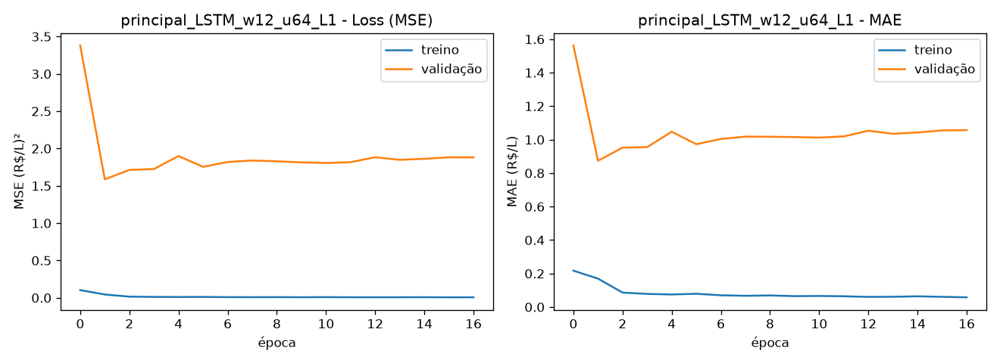

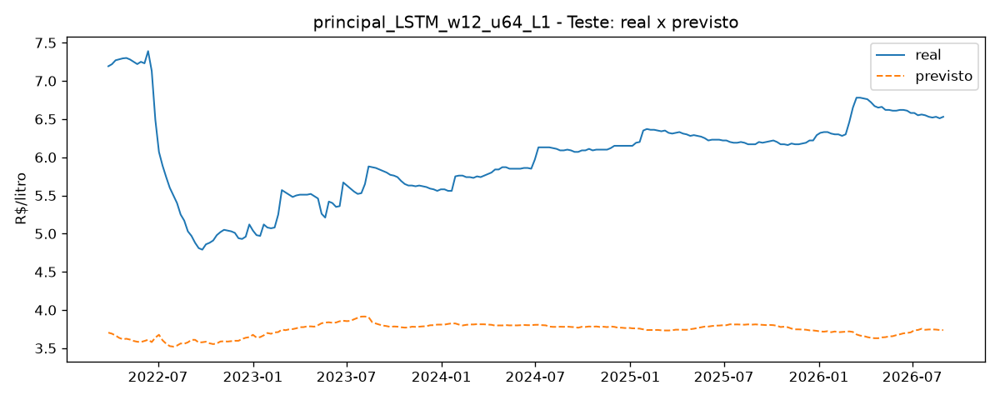

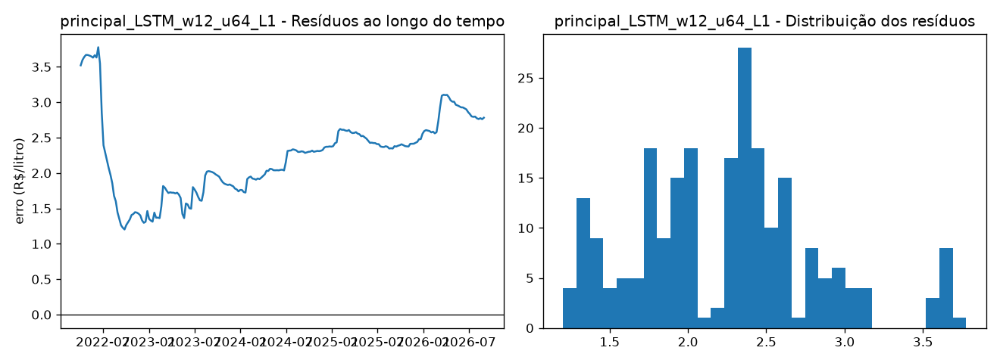

## 6. Avaliação final no conjunto de teste e custo × efetividade

**Nenhum modelo recorrente superou o baseline de persistência**, nem na validação nem
no teste: todos os R² de teste são negativos (entre -4,54 e -16,82), enquanto a
persistência atinge R²=0,979 no teste (MAE 0,039 R$/L, contra 1,25 R$/L do melhor
modelo recorrente). Mesmo na validação, apenas duas configurações têm R² positivo
(0,230 e 0,186). Foram feitas checagens de vazamento (ordem temporal dos splits, alvos de cada
partição dentro do seu período, scalers ajustados só no treino, datas das fronteiras documentadas na seção 3) e não se
encontrou indício de vazamento nem de erro de implementação. A explicação mais consistente com as evidências é a
**distribuição de preços diferente entre treino, validação e teste** (partições por data-base):

| Split | Preço mínimo (R$/L) | Preço máximo (R$/L) | Média (R$/L) |
|---|---:|---:|---:|
| Treino (2004-05 a 2017-08) | 2,08 | 3,78 | 2,79 |
| Validação (2017-09 a 2022-03) | 3,80 | 7,27 | 4,78 |
| Teste (2022-03 a 2026-08) | 4,79 | 7,39 | 5,99 |

Com a divisão 60/20/20, o treino termina em agosto/2017 e cobre apenas preços até
R$ 3,78/L; o preço mínimo de validação (R$ 3,80) já é praticamente o máximo do treino
e o preço mínimo do teste (R$ 4,79) supera em ~R$ 1,01 o máximo do treino — reflexo da
forte alta de preços de combustíveis no Brasil a partir de 2018, e principalmente de
2021-2022. Uma interpretação plausível é que os modelos recorrentes aprendem uma função no espaço padronizado calibrado com as
estatísticas do treino e extrapolam mal para faixas de preço nunca vistas, enquanto a persistência, por não depender de função
ajustada, não é afetada pela mudança de nível. O diagnóstico a seguir e o walk-forward da
seção 14 testam essa hipótese; a separação entre o efeito das features e o do alvo
(ablação) e o uso de preços deflacionados não foram testados.

**Diagnóstico de saturação das ativações** (`python -m src.diagnostics`;
[`results/diagnostico_saturacao.csv`](../results/diagnostico_saturacao.csv)). Na 1ª
configuração (GRU Optuna), o preço da gasolina na entrada, em unidades do scaler do
treino, fica entre −1,6 e 2,3 no treino, mas entre 2,3 e 10,4 na validação e entre 4,6 e
10,7 no teste. Com entradas tão acima da média do treino, as pré-ativações das portas
(sigmoide) e dos candidatos (tanh) ficam grandes, essas funções saturam e a saída deixa de
responder às entradas. A sensibilidade da previsão às entradas (mediana da norma do
gradiente `∂ŷ/∂X`, na escala padronizada) cai de 0,28 no treino para 0,13 na validação e
0,054 no teste; a inclinação da previsão em relação ao preço em `t` cai de 1,19 para 0,24
e 0,10; e, no teste, as previsões ficam entre 4,46 e 4,79 R$/L (desvio padrão de 0,062
R$/L), enquanto o preço real vai de 4,79 a 7,39 R$/L (desvio de 0,566 R$/L). As outras duas
configurações repetem o padrão (inclinação de 0,17 e 0,14 no teste). Já o melhor modelo da
Etapa 2 (log-retornos, seção 12) mantém a sensibilidade (0,68 no treino e 0,59 no teste) e
a inclinação de 1,00 em todas as partições: suas entradas têm choques pontuais fora da
faixa do treino, mas a maioria das semanas fica dentro dela. Portanto, as previsões em
nível ficam **quase constantes** porque as ativações limitadas vistas nas aulas saturam
fora da faixa de treino, e não por acaso ou por erro de implementação.

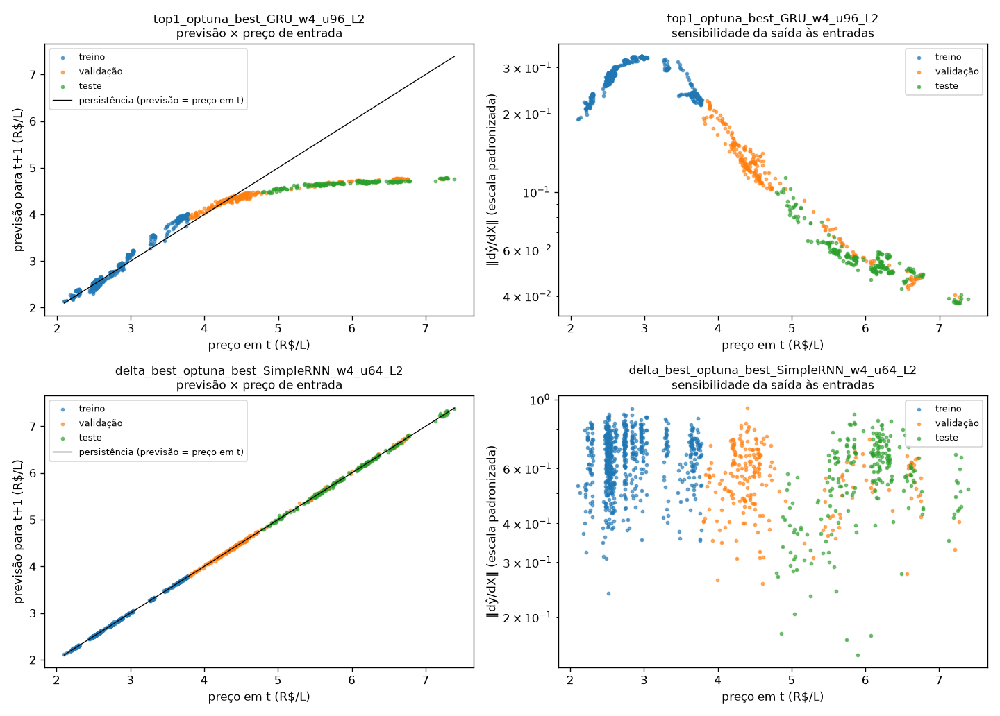

Um indício adicional, compatível com essa interpretação: quase todos os modelos pararam o treinamento
cedo (16 a 24 épocas, com `patience=15`), ou seja, a melhor época da validação ocorreu
nas primeiras épocas (entre a 1ª e a 9ª) e a validação piorou depois disso, possivelmente à medida que o modelo se ajustava ao
patamar de preços do treino. As exceções foram as configurações sem regularização (59 épocas) e com L2
(61 épocas) na grade de regularização.

**Custo computacional**: o pior caso (GRU com 2 camadas, janela 12) treinou em 6,2 s
nesta máquina (Apple Silicon, CPU — `gpu_devices: []`), pois o dataset é pequeno (~680
sequências de treino). Na comparação principal, tempo médio de treino/parâmetros:
SimpleRNN 2,3 s / 4.737, GRU 3,4 s / 14.273, LSTM 3,2 s / 18.753. A 1ª época, que inclui a
construção do grafo, leva de 1 a 3 s e pesa muito no total; sem ela, a mediana do tempo
por época foi de 0,065 s, 0,109 s e 0,097 s, respectivamente. O custo por época cresce com
a janela (média das três arquiteturas: 0,063 s com 4 semanas, 0,090 s com 12 e 0,119 s com
26). Os tempos totais variam de 10% a 20% entre execuções (a média da GRU foi de 3,0 s na
execução anterior e de 3,4 s nesta); a seção 14 compara o tempo por época em 30 treinos
por arquitetura.

## 7. SimpleRNN × GRU × LSTM (análise com base nos experimentos reais)

- **SimpleRNN**: a arquitetura mais leve (4.737 parâmetros com 64 unidades) e a mais
  rápida (2,3 s em média, 0,065 s/época). Desempenho intermediário na comparação
  principal (MAE val 0,849-0,883), melhor que a LSTM em todas as janelas e pior que a
  GRU. Com 128 unidades chegou a 0,622, praticamente empatada com a LSTM de mesma capacidade
  (0,611), mas com ~4× menos parâmetros (17.665 contra 70.273). Neste experimento não
  se pode atribuir a diferença em relação à GRU especificamente a dependências longas:
  janelas maiores não melhoraram nenhuma arquitetura (seção 8).
- **GRU**: foi a arquitetura com melhor desempenho de validação neste experimento —
  melhor das três em todas as janelas da comparação principal (0,742 / 0,788 / 0,818),
  dona das duas melhores configurações gerais e do melhor resultado de teste entre os
  recorrentes (MAE 1,246 R$/L, GRU 128 unidades, janela 12). O custo adicional sobre a
  SimpleRNN foi moderado (~3× parâmetros, ~1,5× o tempo médio). A GRU tem menos
  parâmetros que a LSTM (14.273 contra 18.753 com 64 unidades), mas **não foi mais
  rápida**: 0,109 contra 0,097 s/época na comparação principal e 0,077 contra 0,073
  s/época na mediana dos 30 treinos de cada arquitetura na CV temporal (seção 14). As
  aulas apontam a GRU como mais eficiente que a LSTM por ter menos operações; com matrizes
  pequenas (64 unidades, lotes de 32) em CPU, o tempo parece dominado pelo custo fixo de
  cada passo recorrente, e essa vantagem teórica não apareceu.
- **LSTM**: com 64 unidades teve o **pior** MAE de validação em todas as janelas da
  comparação principal (0,872 / 0,874 / 0,898) e o pior R² de teste, apesar de ter mais
  parâmetros e custo que SimpleRNN e GRU. A capacidade extra só mostrou valor com 128
  unidades (MAE val 0,611, 70.273 parâmetros, 3ª melhor configuração geral), e mesmo assim não superou a GRU de 128
  unidades (0,473). Neste dataset e com a divisão 60/20/20, a LSTM de 64 unidades não justificou seu
  custo adicional. A camada LSTM tem exatamente 4× os parâmetros recorrentes da
  SimpleRNN, a desvantagem apontada nas aulas (mais lenta e com mais portas a ajustar); em
  nível esse custo não trouxe ganho, mas na CV temporal em log-retorno a LSTM empatou com a
  GRU (seção 14).
- Os conjuntos de unidades mostraram um padrão consistente: em todas as três
  arquiteturas, MAE de validação diminuiu monotonicamente de 32 para 64 e para 128
  unidades (SimpleRNN 0,963 → 0,849 → 0,622; GRU 0,835 → 0,788 → 0,473; LSTM 1,038 →
  0,874 → 0,611).

## 8. Janelas temporais

- **4 semanas**: foi suficiente e **a melhor janela** na comparação principal para
  GRU (0,742) e LSTM (0,872, praticamente empatada com 12 semanas, 0,874); para
  SimpleRNN, 12 semanas foi ligeiramente melhor (0,849 contra 0,853).
- **12 semanas**: não trouxe melhora consistente frente a 4 semanas — piorou a GRU
  (0,788) e manteve a LSTM. Ainda assim, foi usada nas grades de unidades e profundidade;
  o melhor resultado entre elas (GRU, 128 unidades) é o 2º colocado geral.
- **26 semanas**: pior MAE de validação das três arquiteturas (0,883 / 0,818 / 0,898) e
  maior custo por época. Não houve evidência de que janelas longas ajudem a capturar
  dependências de mais longo prazo nesta série.
- **Conclusão sobre janelas**: a média do MAE de validação das três arquiteturas
  cresceu com a janela (0,823 com 4 semanas, 0,837 com 12 e 0,866 com 26), e o custo por
  época também (0,063 s, 0,090 s e 0,119 s). A janela de **4 semanas generalizou melhor**
  (menor erro e menor custo). Como apenas ~680 sequências de treino estão disponíveis e a
  variável-alvo já é uma feature em `t`, janelas maiores aumentam a dimensão de entrada
  sem informação adicional relevante para prever 1 semana à frente. A variação entre janelas (diferenças de até ~0,07 R$/L no MAE de validação) é pequena frente ao erro de teste em nível; a hipótese mais consistente para a baixa generalização é a mudança de patamar de preços (seção 6), e não o tamanho da janela.
- **Janelas e BPTT (aulas)**: se o desaparecimento do gradiente pesasse, a SimpleRNN
  deveria piorar mais que as redes com portas ao passar de 4 para 26 passos. No hold-out
  em nível isso não ocorreu (+0,031 R$/L na SimpleRNN, contra +0,075 na GRU e +0,026 na
  LSTM). Na CV temporal em log-retorno (seção 14) há um sinal fraco nessa direção: o MAE
  médio da SimpleRNN passa de 0,0158 para 0,0168 R$/L, enquanto o da GRU fica entre 0,0151
  e 0,0152. Com no máximo 26 passos e dependência útil curta (autocorrelação dos retornos
  até ~9 semanas), o problema de gradiente que motiva LSTM e GRU tem pouco espaço para
  aparecer aqui.

## 9. Profundidade e regularização

- **Profundidade** (1 vs 2 camadas, janela 12, 64 unidades, dropout 0,2): efeito
  dependente da arquitetura. Na GRU, empilhar uma segunda camada **melhorou** o MAE de
  validação (0,788 → 0,691), ao custo de 2,7× mais parâmetros (39.233 contra 14.273) e
  cerca de 1,6× o tempo (6,2 s contra 3,8 s). Na LSTM piorou (0,874 → 0,988; 51.777
  parâmetros, 5,8 s contra 3,6 s). Em ambos os casos o ganho/perda foi pequeno frente ao
  efeito de aumentar unidades em uma única camada (GRU de 128 unidades: 0,473).
- **Regularização** (GRU, janela 4, 64 unidades — melhor candidato da comparação
  principal): sem regularização MAE val 0,690 / teste 1,659 (59 épocas); dropout 0,2
  (comparação principal) 0,742 / 1,833; dropout 0,4 + recurrent dropout 0,2 0,724 /
  1,804; L2 (1e-3, sem dropout) **0,669 / 1,612** (61 épocas). O L2 foi a técnica com
  menor MAE de validação, mas a diferença para nenhuma regularização é pequena (~3%) e, com execução única, não deve ser
  tomada como significativa; o dropout (ruído estocástico) não
  trouxe ganho neste problema de séries pequenas e fora da faixa de treino.
- **Optuna**: a busca encontrou uma GRU com 2 camadas, 96 unidades e `batch_size=64`
  (MAE val 0,435), melhorando em ~41% o melhor da comparação principal (0,742) e em
  ~35% a melhor configuração da grade de regularização (0,669). Os três melhores
  trials usaram `batch_size=64` e `learning_rate` alto (2,4e-3 a 4,6e-3).
- Nenhuma configuração exibiu explosão de loss ou NaN, por isso o clipping de gradiente não
  foi necessário. As previsões em nível no teste, porém, ficaram **quase constantes**: na
  1ª configuração, o desvio padrão das previsões foi de 0,062 R$/L, contra 0,566 R$/L do
  preço real, efeito da saturação das ativações (seção 6). O sinal de overfitting
  predominante é o da seção 6: melhor época de validação nas primeiras épocas e piora
  subsequente por ajuste ao patamar de preços do treino.

## 10. Limitações

- **Distribuição não estacionária**: como discutido na seção 6, o preço da gasolina
  mudou de patamar após o treino (2018-2022), e validação e teste ficaram em grande
  parte fora da faixa vista no treino. Isso limita a validade de qualquer modelo
  treinado com normalização fixa; em um cenário real, seria necessário re-treinar
  periodicamente ou modelar variações (diferenças/retornos) em vez do nível de preço. A
  seção 14 mede o efeito do re-treino periódico (walk-forward) e a seção 12, o da
  modelagem em retornos.
- **Causa isolada só em parte**: a associação entre a falha em nível e a mudança de patamar de preços agora tem evidência direta: saturação das ativações fora da faixa do treino (seção 6), erro que cresce com a distância de extrapolação nos 5 folds da CV temporal e cai com o re-treino (seção 14). Ainda assim, não houve ablação separando features e alvo, nem teste com outro pré-processamento (por exemplo, preços deflacionados), então outras causas (mudanças de regime, de volatilidade e de abrangência da pesquisa) não podem ser descartadas.
- **Seleção de modelos no hold-out**: como a própria validação também está fora da faixa
  de treino, o MAE de validação é um critério ruidoso para escolher entre modelos que
  extrapolam mal; os rankings entre arquiteturas variaram entre os recortes 70/15/15 e
  60/20/20. A CV temporal da seção 14 dá um critério mais estável e, em log-retorno,
  inverte o ranking da validação simples.
- **Dataset pequeno para deep learning**: apesar de cobrir 22 anos, a granularidade
  semanal produz apenas ~1150 observações (~680 sequências de treino).
- **Execução única por configuração**: no hold-out, cada configuração foi treinada uma
  vez com seed=42; diferenças pequenas entre configurações (por exemplo, SimpleRNN-128
  0,622 e LSTM-128 0,611) não devem ser interpretadas como significativas. A CV temporal
  dá 5 estimativas por configuração, mas também com uma única seed por fold.
- **Optuna e CV não cobriram todo o espaço**: a busca variou dropout e não L2, e foi
  feita apenas para a arquitetura/janela vencedora da comparação principal (GRU, janela
  4); a CV temporal cobriu só a grade principal (64 unidades, 1 camada, dropout 0,2).
- **Baseline forte**: para preços com alta autocorrelação semana a semana, a
  persistência (o método ingênuo) é um adversário muito difícil de superar com poucos
  dados e com a variável de preço entre as próprias features, o que é conhecido na
  literatura de previsão de séries econômicas (MEESE; ROGOFF, 1983; HYNDMAN;
  ATHANASOPOULOS, 2021).

## 11. Conclusão da Etapa 1 (previsão em nível de preço)

A arquitetura GRU apresentou o melhor desempenho relativo entre as redes recorrentes
avaliadas, obtendo os menores valores de MAE de validação nas três janelas temporais
investigadas. A otimização de hiperparâmetros com Optuna reduziu o MAE de validação
para 0,435 R$/L. Esse resultado não deve ser atribuído às portas da GRU: a LSTM, que também
tem portas, foi a pior na comparação principal; a SimpleRNN de 128 unidades, sem portas,
empatou com a LSTM de mesma capacidade (0,622 contra 0,611); e janelas mais longas não
ajudaram nenhuma arquitetura (seção 8). Uma vantagem das portas só aparece, pequena, na CV
temporal em log-retorno (seção 14).

Entretanto, a avaliação no conjunto de teste revelou uma degradação significativa do
desempenho, com MAE de 1,322 R$/L e R² de -5,265. Além disso, o baseline de persistência
apresentou resultados substancialmente superiores. Portanto, embora a GRU tenha sido a
arquitetura neural mais promissora na etapa de validação, os resultados não sustentam
sua superioridade preditiva em relação ao baseline. A causa da degradação é investigada
nas seções 6 (saturação das ativações), 12 (log-retornos), 13 (outros splits) e 14
(validação cruzada temporal e walk-forward).

Detalhamento: sob um protocolo controlado (mesmos dados, split 60/20/20, normalização, otimizador,
loss e callbacks), a **GRU foi a arquitetura recorrente mais eficaz** para prever o
preço da gasolina em `t+1` neste recorte: ficou com as duas melhores configurações, com
destaque para a busca Optuna (GRU de 2 camadas, 96 unidades, janela de 4 semanas) e para
GRU com 128 unidades; a terceira melhor foi uma LSTM com 128 unidades. A SimpleRNN foi a mais leve e rápida, e a LSTM com 64 unidades foi
a menos eficaz, só se aproximando das demais com 128 unidades. Janelas curtas (4
semanas) e mais unidades foram os fatores que mais reduziram o erro de
validação; o L2 teve efeito pequeno. Nenhuma das três arquiteturas superou o baseline de persistência no conjunto
de teste (nem na validação), resultado que as evidências associam à mudança de patamar de preços entre treino e validação/teste, que leva as ativações da rede à saturação (seção 6); as checagens realizadas não indicaram vazamento de dados nem erro de implementação. Os números desta etapa
foram extraídos de `results/experiments.csv`, `results/optuna_trials.csv`,
`results/diagnostico_saturacao.csv` e do log da execução de `python -m src.run_experiments`.

## 12. Etapa 2 — Reformulação com log-retornos (tratamento da não estacionariedade)

A própria validação já mostrava a falha da formulação em nível, sem precisar do teste: R² de validação negativo em 19 das 21 configurações e MAE de validação pelo menos 12 vezes o da persistência. Como a causa mais consistente é a mudança de patamar de preços, que satura as ativações (seção 6), o problema foi reformulado: features e alvo passaram a ser **log-retornos semanais**
(`log(x_t / x_{t-1})` nas features; alvo `r = log(y_{t+1} / y_t)`), e o preço previsto é
reconstruído como `y_t · exp(r̂)`. A persistência equivale a `r̂ = 0`. Mesmo split
60/20/20, escalonamento ajustado só no treino, mesma grade (3 janelas × 3 arquiteturas,
64 unidades, dropout 0,2) e mesma busca Optuna (20 tentativas; melhor: 64 unidades, 2
camadas, dropout 0,125, `learning_rate` 5,0e-4 e `batch_size` 16), com métricas em R$/L.
Código em `src/run_experiments_delta.py`; resultados em
[`results/experiments_delta.csv`](../results/experiments_delta.csv),
`results/optuna_delta_trials.csv` e `results/optuna_delta_best_params.json`.

| Modelo | MAE val | MAE teste | RMSE teste | R² teste |
|---|---:|---:|---:|---:|
| Persistência | 0,0356 | 0,0390 | 0,0816 | 0,9792 |
| GRU w4 (nível, Optuna — seção 5) | 0,435 | 1,322 | 1,417 | -5,265 |
| SimpleRNN w4 (retorno, 64 un.) | 0,0323 | 0,0404 | 0,0774 | 0,9813 |
| GRU w4 (retorno, 64 un.) | 0,0332 | 0,0411 | 0,0814 | 0,9794 |
| LSTM w4 (retorno, 64 un.) | 0,0342 | 0,0409 | 0,0820 | 0,9790 |
| **SimpleRNN w4 (retorno, Optuna: 64 un., 2 camadas)** | **0,0313** | 0,0412 | 0,0793 | 0,9804 |

- O MAE de teste caiu de 1,322 para ~0,041 R$/L (redução de ~97%) e o R² de teste foi de
  -5,265 para ~0,98, o que é consistente com a hipótese de que a falha anterior estava associada à representação (nível de preço não estacionário) e não apenas à capacidade das redes. Como features e alvo foram alterados em conjunto, o experimento não isola o efeito de cada mudança nem prova que essa seja a única causa.
- Frente à persistência, os modelos de retorno têm **MAE de validação menor** (0,0313
  contra 0,0356) e **RMSE de teste ligeiramente menor** (0,077-0,079 contra 0,082 nos
  modelos SimpleRNN), mas **MAE de teste praticamente igual ou levemente pior** (0,0398 a 0,0416 contra
  0,0390). Portanto, as redes agora igualam o baseline, sem evidência de superioridade
  clara; diferenças dessa magnitude vêm de uma única execução (seed 42) e não devem ser
  tratadas como significativas.
- Com a representação estacionária, o ranking entre arquiteturas mudou: a SimpleRNN
  ficou na frente da GRU e da LSTM nas janelas de 4 e 26 semanas (na de 12, a GRU foi
  marginalmente melhor: 0,0339 contra 0,0341) e foi escolhida pelo Optuna, de modo que a
  superioridade da GRU observada na seção 4 está associada ao regime de extrapolação em
  nível, e não a uma vantagem geral da arquitetura. Isso é coerente com a orientação das
  aulas de que a SimpleRNN basta para sequências curtas e com a equivalência entre GRU e
  LSTM relatada por Chung et al. (2014).

## 13. Sensibilidade ao split cronológico (Etapas 1 e 2; 70/15/15, 75/15/10, 80/10/10)

Para verificar se o problema de generalização depende da divisão temporal, foram
repetidos os experimentos com três splits adicionais, comparados ao 60/20/20 original.
Em cada split: 3 arquiteturas × 3 janelas (64 unidades, 1 camada, dropout 0,2, seed 42),
nos dois alvos (preço em nível e log-retorno, seção 12), mais a persistência calculada
nas mesmas amostras de validação/teste. Todas as métricas em R$/L. Código em
`src/run_experiments_splits.py`; resultados completos em
[`results/experiments_splits.csv`](../results/experiments_splits.csv).

**Cobertura de preços do treino em cada split** (validação e teste são sempre posteriores; semanas por data-base):

| Split | Treino até (base) | Sem. treino/val/teste | Preço máx. treino | Preço mín.–máx. teste |
|---|---|---:|---:|---:|
| 60/20/20 | 2017-08-27 | 690 / 230 / 232 | 3,78 | 4,79–7,39 |
| 70/15/15 | 2019-11-10 | 805 / 172 / 175 | 4,72 | 5,21–6,78 |
| 75/15/10 | 2021-02-14 | 863 / 172 / 117 | 4,92 | 5,85–6,78 |
| 80/10/10 | 2022-03-20 | 920 / 115 / 117 | 7,27 | 5,85–6,78 |

**Alvo em nível** (melhor configuração por MAE de validação em cada split):

| Split | Melhor config. (val) | MAE val | MAE teste | R² teste | Persistência: MAE teste | Persistência: R² teste |
|---|---|---:|---:|---:|---:|---:|
| 60/20/20 | GRU, janela 4 | 0,742 | 1,833 | -10,51 | 0,0390 | 0,9792 |
| 70/15/15 | LSTM, janela 12 | 0,592 | 0,659 | -2,91 | 0,0257 | 0,9775 |
| 75/15/10 | LSTM, janela 26 | 0,562 | 0,702 | -11,21 | 0,0195 | 0,9648 |
| 80/10/10 | LSTM, janela 12 | 0,238 | 0,085 | 0,65 | 0,0195 | 0,9648 |

**Alvo em log-retorno** (melhor configuração por MAE de validação em cada split):

| Split | Melhor config. (val) | MAE val | MAE teste | RMSE teste | R² teste | Persistência: MAE val / MAE teste / RMSE teste |
|---|---|---:|---:|---:|---:|---|
| 60/20/20 | SimpleRNN, janela 4 | 0,0323 | 0,0404 | 0,0774 | 0,9813 | 0,0356 / 0,0390 / 0,0816 |
| 70/15/15 | GRU, janela 26 | 0,0483 | 0,0275 | 0,0523 | 0,9778 | 0,0582 / 0,0257 / 0,0527 |
| 75/15/10 | LSTM, janela 4 | 0,0522 | 0,0237 | 0,0369 | 0,9678 | 0,0571 / 0,0195 / 0,0386 |
| 80/10/10 | LSTM, janela 4 | 0,0529 | 0,0237 | 0,0364 | 0,9686 | 0,0589 / 0,0195 / 0,0386 |

Observações:

- **Em nível, o erro de teste cai à medida que o treino cobre faixas de preço mais
  altas**: média das 9 configurações de 2,03 R$/L (60/20/20) para 1,01 (70/15/15),
  0,93 (75/15/10) e 0,13 (80/10/10). Só no 80/10/10, em que o treino já contém o pico de
  R$ 7,27 e todo o intervalo de preços do teste, o R² de teste fica positivo em 7 das 9
  configurações (0,65 na melhor; GRU e LSTM com janela de 26 semanas ainda ficam negativos,
  −0,58 e −0,05; as médias por arquitetura variam de 0,23 a 0,48). Mesmo assim o
  MAE (0,085 na melhor, 0,13 na média) é 4 a 7 vezes o da persistência (0,0195). Isso é consistente com a hipótese de que a falha em nível está ligada à extrapolação para faixas de preço não vistas, embora o experimento não isole essa causa de outras diferenças entre os períodos (volatilidade, regime de preços).
- **Em log-retorno, o erro é estável e baixo em todos os splits** (R² de teste de 0,96 a
  0,98), e a conclusão da seção 12 se mantém: o **MAE de validação é menor que o da
  persistência na melhor configuração de todos os splits** (por exemplo 0,0529 contra 0,0589 no 80/10/10; em média
  das 9 configurações, também em todos), o
  **RMSE de teste é menor que o da persistência** em 5, 9, 8 e 9 das 9 configurações
  (60/20/20, 70/15/15, 75/15/10 e 80/10/10; p. ex. média da GRU de 0,0346 contra 0,0386 no 80/10/10), mas o **MAE de teste é sempre pior que o da
  persistência** (mínimo/média entre as 9 configurações: 0,0398/0,0408 contra 0,0390 no 60/20/20; 0,0270/0,0285 contra 0,0257 no 70/15/15; 0,0227/0,0237 contra 0,0195 no 75/15/10; 0,0214/0,0229 contra 0,0195 no 80/10/10). Ou seja, as redes
  reduzem erros grandes (RMSE) em parte dos casos, mas não superam a persistência nos erros típicos (MAE).
- **Splits com teste menor são mais sensíveis**: nos splits 75/15/10 e 80/10/10 o teste
  tem 117 semanas (os dois compartilham o mesmo conjunto de teste, de modo que a
  persistência é idêntica), e as diferenças entre modelos (≈0,001-0,002 R$/L) são
  pequenas diante da variabilidade esperada. Os MAE e RMSE absolutos não são comparáveis
  entre splits, pois os períodos de teste diferem; a comparação válida é sempre contra a
  persistência no mesmo split.
- **A melhor arquitetura varia conforme o split e o alvo** (GRU, LSTM e SimpleRNN
  aparecem como melhores por MAE de validação), com diferenças pequenas e execução única
  por configuração; não há base para apontar uma arquitetura como superior de forma
  geral.
- **Conclusão da seção**: o split mais favorável para o alvo em nível é o 80/10/10, mas
  isso ocorre por incluir no treino o patamar de preços recente; a reformulação em log-retorno manteve desempenho estável em todos os splits avaliados. Em nenhum cenário as redes
  superaram claramente o baseline de persistência no conjunto de teste.

## 14. Validação cruzada temporal (TimeSeriesSplit) e walk-forward com re-treino

As seções 4 a 13 usam um único hold-out cronológico por split. Para uma única série
temporal, as aulas recomendam a validação cruzada com janela expansível
(`TimeSeriesSplit`): cada fold treina só com o passado e avalia o bloco seguinte, sem
informação privilegiada do futuro. Ela foi aplicada de duas formas, com a grade principal
(3 arquiteturas × 3 janelas, 64 unidades, 1 camada, dropout 0,2) e nos dois alvos. Código
em `src/run_experiments_cv.py`; resultados em
[`results/cv_temporal.csv`](../results/cv_temporal.csv) e
[`results/walk_forward.csv`](../results/walk_forward.csv).

- **Parte A — CV no período de desenvolvimento** (amostras com data-base até 2022-03-20,
  ou seja, treino + validação do split 60/20/20; o teste não é usado):
  `TimeSeriesSplit(n_splits=5, test_size=150)`, isto é, 5 blocos consecutivos de 150
  semanas (o 1º de 2007-08-26 a 2010-07-18 e o último de 2019-03-17 a 2022-03-20), cada um
  avaliado por um modelo treinado com todas as semanas anteriores (de 167 a 767 amostras
  com janela de 4 semanas).
- **Parte B — walk-forward no período de teste**: `TimeSeriesSplit(n_splits=4,
  test_size=58)` sobre a série inteira, cujos 4 blocos de 58 semanas são exatamente as 232
  semanas de teste do split 60/20/20 (2022-03-27 a 2026-08-30). Antes de cada bloco, o
  modelo é re-treinado com todo o histórico anterior, como seria feito em produção.
- Em cada fold, os scalers são ajustados só nas semanas de treino do fold, o early
  stopping usa as últimas 26 semanas desse histórico (assim o ajuste inclui o patamar de
  preços mais recente) e o bloco avaliado nunca entra no treino. Métricas em R$/L, sempre
  contra a persistência nas mesmas semanas.

**Parte A — MAE médio na CV (desvio entre os 5 folds), em R$/L**

| Alvo | Janela | SimpleRNN | GRU | LSTM | Persistência |
|---|---:|---:|---:|---:|---:|
| Nível | 4 | 0,313 (0,254) | **0,285** (0,222) | 0,340 (0,249) | 0,0165 |
| Nível | 12 | 0,318 (0,274) | 0,290 (0,228) | 0,336 (0,245) | 0,0165 |
| Nível | 26 | 0,327 (0,271) | 0,327 (0,236) | 0,323 (0,228) | 0,0165 |
| Log-retorno | 4 | 0,0158 (0,0125) | 0,0152 (0,0122) | 0,0153 (0,0122) | 0,0165 |
| Log-retorno | 12 | 0,0168 (0,0123) | 0,0152 (0,0126) | 0,0158 (0,0134) | 0,0165 |
| Log-retorno | 26 | 0,0168 (0,0117) | **0,0151** (0,0126) | 0,0153 (0,0128) | 0,0165 |

- **Nível**: o erro cresce fold a fold com a distância entre o preço máximo do treino e o
  do bloco avaliado. No fold 1 (máximo do treino 2,60 R$/L; do bloco, 2,62), o MAE fica
  entre 0,016 e 0,089 R$/L; no fold 5 (máximo do treino 4,72; do bloco, 7,27), entre 0,56
  e 0,65 R$/L. É o efeito de saturação da seção 6 observado em 5 origens diferentes, e não
  só no split 60/20/20. Em média, as redes em nível erram de 17 a 21 vezes mais que a
  persistência.
- **Log-retorno**: GRU e LSTM têm MAE médio de 0,0151 a 0,0158 R$/L, contra 0,0165 da
  persistência, e a superam em 3 ou 4 dos 5 folds; a SimpleRNN, em apenas 1 ou 2. Todas as
  configurações perdem para a persistência no fold 1 (2007–2010, o período mais calmo, em
  que ela erra só 0,0047 R$/L) e todas a superam no fold 5 (2019–2022, alta volatilidade).
- **Arquiteturas**: em comparação pareada fold a fold, a GRU erra menos que a SimpleRNN
  em 4, 4 e 5 dos 5 folds (janelas de 4, 12 e 26 semanas), e a LSTM em 4, 3 e 5; GRU e
  LSTM ficam praticamente empatadas, como em Chung et al. (2014). A CV inverte, portanto,
  o ranking da validação simples (seção 12, em que a SimpleRNN ficou à frente). As
  diferenças entre arquiteturas (até 0,0017 R$/L) são pequenas frente ao desvio entre
  folds (~0,012 R$/L, que reflete sobretudo a volatilidade de cada período), por isso a
  comparação pareada é mais informativa que a média.
- **Escolha pela CV** (sem usar o teste): em nível, GRU com janela de 4 semanas (a mesma
  da validação simples); em log-retorno, GRU com janela de 26 semanas (0,0151),
  praticamente empatada com a GRU de 4 e 12 semanas e com a LSTM de 4 e 26 semanas (até
  0,0002 R$/L de diferença).

**Parte B — walk-forward no teste (232 semanas), MAE em R$/L** (entre parênteses, o MAE da
mesma configuração treinada uma única vez no hold-out 60/20/20, seções 4 e 12)

| Alvo | Janela | SimpleRNN | GRU | LSTM | Persistência |
|---|---:|---:|---:|---:|---:|
| Nível | 4 | 0,336 (2,018) | 0,195 (1,833) | **0,180** (2,118) | 0,0390 |
| Nível | 12 | 0,359 (1,966) | 0,221 (1,887) | 0,182 (2,250) | 0,0390 |
| Nível | 26 | 0,419 (2,008) | 0,221 (1,926) | 0,209 (2,288) | 0,0390 |
| Log-retorno | 4 | 0,0405 (0,0404) | 0,0395 (0,0411) | **0,0388** (0,0409) | 0,0390 |
| Log-retorno | 12 | 0,0402 (0,0415) | 0,0392 (0,0416) | 0,0392 (0,0407) | 0,0390 |
| Log-retorno | 26 | 0,0421 (0,0412) | 0,0389 (0,0403) | 0,0394 (0,0398) | 0,0390 |

- **Nível**: re-treinar a cada 58 semanas reduz o MAE de teste de 1,83–2,29 para 0,18–0,42
  R$/L (de 79% a 92% menos) e leva o R² de teste de valores negativos para 0,22–0,79,
  porque cada modelo passa a ver o patamar de preços recente. Ainda assim, o erro fica de
  4,6 a 10,7 vezes o da persistência e é maior no 1º bloco (2022-03-27 a 2023-04-30: MAE
  de 0,40 a 0,74 R$/L), quando o preço caiu de 7,39 para 4,79 R$/L logo após o pico. GRU
  e LSTM (0,18 a 0,22 R$/L) erram menos que a SimpleRNN (0,34 a 0,42) em todas as janelas.
- **Log-retorno**: o re-treino reduz o MAE em 7 das 9 configurações (até 5,8%), e as
  configurações com portas ficam entre 0,0388 e 0,0395 R$/L, praticamente iguais à
  persistência (0,0390). A escolhida pela CV (GRU, janela 26) tem MAE de 0,0389 e RMSE de
  0,0748, 8% menor que o da persistência (0,0816); a LSTM com janela 4 tem o menor MAE
  (0,0388). As 9 configurações têm RMSE de teste menor que o da persistência (de 0,0748 a
  0,0792), ou seja, erram menos nas semanas de grandes variações. A SimpleRNN fica atrás
  (de 0,0402 a 0,0421), como na CV.
- **Custo**: mediana do tempo por época de 0,060 s (SimpleRNN), 0,077 s (GRU) e 0,073 s
  (LSTM) nos 30 treinos de cada arquitetura na CV, e de 0,105 s, 0,196 s e 0,159 s no
  walk-forward, com históricos maiores. A GRU foi a mais lenta por época nos dois casos
  (seção 7).

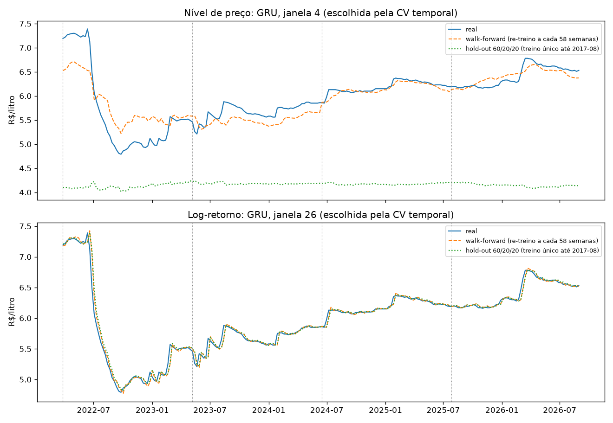

Na figura, as linhas verticais marcam os re-treinos. Em nível, o modelo treinado uma única
vez fica preso em ~4,1 R$/L (saturação), enquanto o re-treinado acompanha o patamar de
preços com defasagem; em log-retorno, as duas versões praticamente coincidem com o preço
real.

**Conclusão da seção**: avaliada como nas aulas (CV temporal) e como seria usada na
prática (re-treino periódico), a formulação em log-retornos com GRU ou LSTM empata com a
persistência no MAE e fica um pouco melhor no RMSE; a formulação em nível melhora muito com
o re-treino, mas continua bem pior que a persistência. A vantagem das portas sobre a
SimpleRNN aparece de forma consistente na CV e no walk-forward, ao contrário do que
sugeria a validação simples.

## 15. Comparação final com a persistência e conclusão geral

Conjunto de teste do split 60/20/20 (alvos de 2022-04-03 a 2026-09-06, 232 amostras): melhor
modelo por MAE de validação em cada etapa (ambos com busca Optuna, treinados uma vez) e
configurações escolhidas pela CV temporal, avaliadas com re-treino a cada 58 semanas (seção
14), contra o baseline:

| Modelo | MAE val | MAE teste | RMSE teste | R² teste |
|---|---:|---:|---:|---:|
| Etapa 1 — GRU em nível (Optuna) | **0,435** | 1,322 | 1,417 | -5,265 |
| Etapa 2 — SimpleRNN em log-retorno (Optuna) | **0,0313** | 0,0412 | 0,0793 | 0,9804 |
| Walk-forward — GRU em nível, janela 4 (CV) | – | 0,195 | 0,273 | 0,768 |
| Walk-forward — GRU em log-retorno, janela 26 (CV) | – | **0,0389** | **0,0748** | **0,9825** |
| Persistência | 0,0356 | 0,0390 | 0,0816 | 0,9792 |

- **Etapa 1**: a GRU foi a melhor rede recorrente na validação, mas a avaliação em teste
  mostra generalização insatisfatória: fora da faixa de preços do treino as ativações
  saturam e as previsões ficam quase constantes (seção 6); as checagens realizadas não
  indicaram vazamento nem erro de implementação. Re-treinando a cada 58 semanas (seção
  14), o MAE de teste em nível cai de 1,8–2,3 para 0,18–0,42 R$/L, mas continua de 4,6 a
  10,7 vezes o da persistência.
- **Etapa 2**: a representação em log-retorno reduz o MAE de teste em ~97% e leva o R²
  de teste a ~0,98; a SimpleRNN foi a melhor arquitetura na validação simples, mas na CV
  temporal GRU e LSTM ficaram à frente (seção 14).
- **Persistência**: entre os modelos treinados uma vez, tem o **menor MAE de teste**
  (0,0390): a rede da Etapa 2 escolhida pelo Optuna fica a ~0,002 R$/L (0,0412) e a melhor
  configuração de teste da Etapa 2, a ~0,001 R$/L (0,0398). Com re-treino periódico, a GRU
  em log-retorno escolhida pela CV empata no MAE (0,0389 contra 0,0390) e tem RMSE 8% menor
  (0,0748 contra 0,0816); a LSTM com janela de 4 semanas chega a 0,0388. Diferenças de
  0,0001 a 0,0002 R$/L no MAE, com uma seed, são empate. Nos demais splits (seção 13), a
  persistência também mantém o menor MAE de teste.
- **Conclusão geral**: a maior melhora observada coincidiu com a mudança de representação (log-retornos) e foi muito maior que as diferenças entre arquiteturas; como a mudança foi feita em conjunto (features e alvo), o ganho é atribuído à reformulação como um todo, sem isolar cada componente. O re-treino periódico vem em seguida: decisivo em nível e marginal em log-retorno. Avaliada com a CV temporal recomendada nas aulas, a comparação entre arquiteturas favorece as células com portas (GRU e LSTM, praticamente empatadas) sobre a SimpleRNN, em linha com as aulas e com Chung et al. (2014), mas com diferenças pequenas. Com a representação adequada e re-treino, as redes recorrentes igualam a persistência no MAE e a superam ligeiramente no RMSE, sem superioridade clara.

## Anexo — Tabelas do dataset no DuckDB (visualização no DBeaver)

Complemento visual das tabelas do banco `datasets/anp.duckdb`, criadas por
[`datasets/init.sql`](../datasets/init.sql). As capturas mostram as primeiras 200 linhas
de cada tabela.

**`precos_semanal_raw`** — importação direta das duas planilhas da ANP
(`semanal-brasil-2004-a-2012.xlsx` e `semanal-brasil-desde-2013.xlsx`), sem remoção de
duplicatas, com todos os produtos e a coluna `arquivo_origem`.

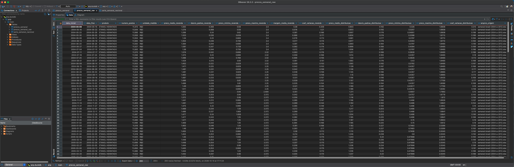

**`precos_semanal`** — mesma estrutura, sem as semanas repetidas na fronteira entre os
dois arquivos, ordenada por `data_inicial` e `produto`.

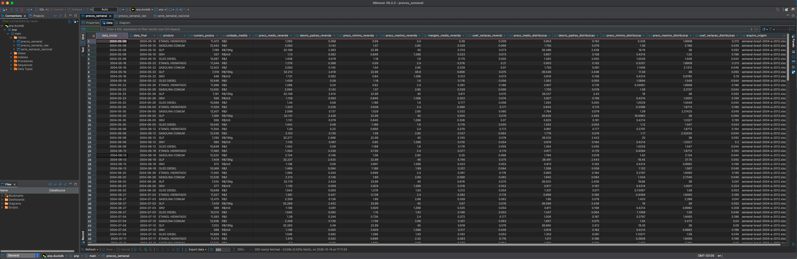

**`serie_semanal_nacional`** — série processada usada nos experimentos: as 8 features
(gasolina, etanol e diesel) e o alvo `target_gasolina_t_plus_1`, uma linha por semana
(1152 semanas).

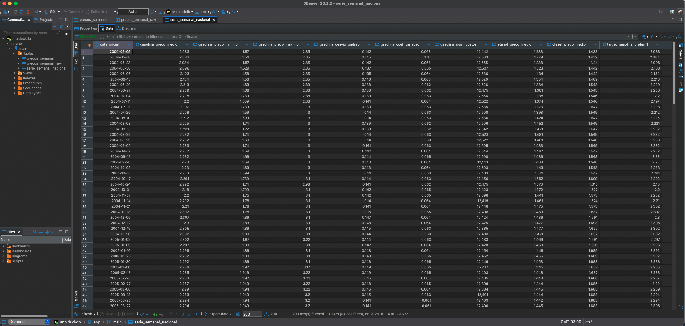
